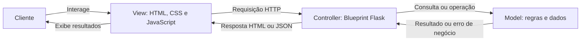

# Arquitetura MVC — Livraria Entrelinhas

A aplicação separa as responsabilidades de Model, View e Controller.
Ela consiste em um único programa Flask, com
frontend funcional e dados em memória.

## Responsabilidades

| Parte | Arquivos | Responsabilidade |
| --- | --- | --- |
| Model | `models/livraria.py` | Catálogo, estoque, reservas, fidelidade, comunidade e preferências; dados e regras independentes do Flask. |
| Dados demonstrativos | `models/demonstracao.py` | Criação do catálogo, horários, eventos e clube ilustrativos. |
| View | `templates/index.html`, `static/css/app.css`, `static/js/app.js` | Apresentação, captura de ações, requisições HTTP e atualização da interface. |
| Controller | `controllers/livraria_controller.py` | Rotas, sessão do cliente, validação do formato da requisição, chamadas ao Model e respostas HTML/JSON. |
| Inicialização | `app.py` | Configura o Flask, cria o Model e registra o Blueprint do Controller. |
| Compatibilidade | `livraria.py` | Reexporta classes e função públicas do Model para os exemplos e testes anteriores. |

O Model concentra as validações de negócio, como disponibilidade de estoque e
validade do prazo de uma reserva. O Controller valida o formato HTTP, como
corpo JSON e presença de campos obrigatórios. A View apresenta os resultados
e permite que o cliente execute as ações disponíveis.

## Comunicação



O Controller entrega o template na rota `/` e retorna JSON nas rotas `/api/`.
O JavaScript da View usa esses endereços para atualizar a interface. Não há
acesso direto da View aos objetos Python do Model.

## Exemplo: reserva de livro

1. O cliente escolhe um livro e informa prazo e opção de embrulho na View.
2. A View envia `POST /api/reservas` com os dados em JSON.
3. O Controller identifica o cliente pela sessão e valida o formato da entrada.
4. O Model verifica livro, estoque, prazo e opção de embrulho. Se a operação
   for válida, registra a reserva e reduz o estoque atomicamente.
5. O Controller retorna a reserva com status HTTP 201, ou o erro correspondente.
6. A View consulta o estado atualizado e apresenta a confirmação ou mensagem de erro.

## Organização e execução

Cada chamada a `create_app(livraria=None)` configura uma aplicação e registra
seu Controller. É possível fornecer um Model específico para testes; quando
ele não é informado, a aplicação recebe dados demonstrativos próprios.

O comando de execução continua sendo:

```powershell
.venv\Scripts\python.exe app.py
```

Abra <http://127.0.0.1:5000>. O navegador carrega o HTML e os arquivos locais
em `/static/css/app.css` e `/static/js/app.js`.

Os dados são mantidos em memória e se perdem ao reiniciar o servidor. A sessão
identifica o cliente para esta demonstração; não implementa autenticação.
O escopo funcional e o contrato HTTP continuam em [livraria.md](specs/livraria.md).
As verificações realizadas estão em [Validação MVC](validacao-mvc.md).
