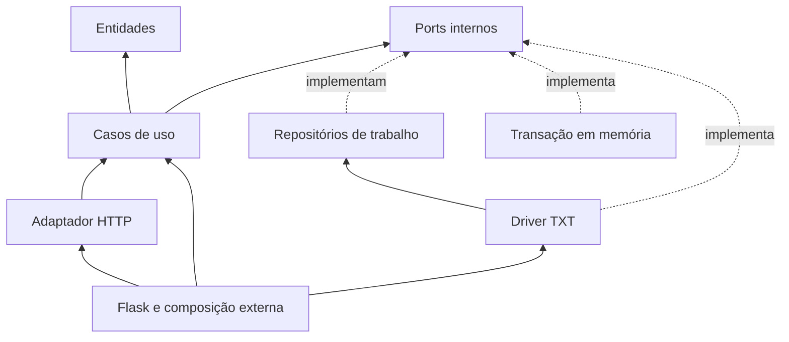
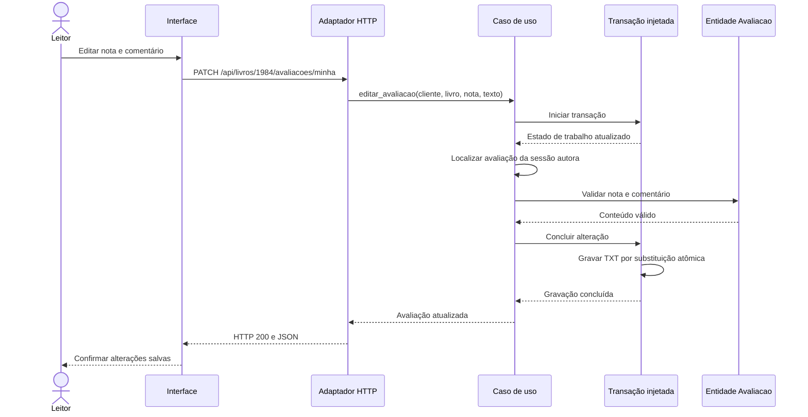

# Clean Architecture — Livraria Entrelinhas

A aplicação mantém o negócio independente de Flask e da tecnologia de
armazenamento. As dependências do código apontam para entidades, casos de uso
e contratos internos. A composição externa escolhe os adaptadores em memória
ou a persistência em arquivo TXT.

## Organização

| Parte | Arquivos | Responsabilidade |
| --- | --- | --- |
| Entidades | `entities/regras.py`, `entities/avaliacao.py` | Regras de datas, quantidades, reservas, preferências e conteúdo válido das avaliações. |
| Casos de uso | `use_cases/livraria.py` | Coordenar as operações da livraria por contratos de dados e transações, sem construir tecnologias externas. |
| Ports | `use_cases/ports.py` | Definir `LivrosPort`, `EstadoPort` e `TransacaoPort` como Protocols internos. |
| Adaptadores de interface | `interface_adapters/http.py`, `interface_adapters/repositories.py` | Traduzir HTTP e implementar as interfaces de acesso ao estado de trabalho. |
| Frameworks e drivers | `infrastructure/web.py`, `infrastructure/transactions.py`, `infrastructure/txt.py` | Configurar Flask e executar transações em memória ou com snapshot TXT. |
| Composição | `infrastructure/composition.py`, `app.py`, `demonstracao.py` | Conectar os casos de uso a suas dependências e inicializar dados ilustrativos uma única vez. |

Os arquivos em `domain/`, `services/`, `repositories/`, `controllers/`,
`models/` e `livraria.py` preservam os imports públicos anteriores por
compatibilidade. A implementação do núcleo fica em `entities/` e `use_cases/`.

## DIP e direção das dependências

O núcleo recebe repositório de livros, estado e transação por injeção.
Ele não importa Flask, JSON, Path, locks ou implementações concretas.
O adaptador HTTP chama os casos de uso e não manipula o arquivo diretamente.

O driver TXT usa os repositórios de trabalho e implementa a fronteira de
transação. Ele carrega o estado, executa a operação e salva o resultado completo.
Trocar essa transação pela implementação em memória não exige alterar as regras
nem os casos de uso. Os testes executam a mesma edição com os dois adaptadores.

## Edição da própria avaliação

A edição preserva id, autor público e data original, atualiza nota e comentário
e registra `atualizada_em`. Ela não cria uma segunda avaliação. A rota atua
somente sobre a avaliação da própria sessão; o corpo aceita apenas `nota` e
`texto`. O GET de detalhes informa `minha_avaliacao` ou null.

O formulário abre preenchido e permite cancelar sem enviar alterações.
Erros mantêm o rascunho. A confirmação usa a resposta do PATCH e atualiza a
publicação sem depender de uma consulta posterior. O texto é escapado em todas
as renderizações, inclusive depois de editar.

## Persistência em TXT

A execução normal salva `instance/livraria.txt`, um documento JSON legível
em UTF-8 com `versao: 1`, catálogo e estado completo da livraria.
Conjuntos são representados por listas e reconstruídos na leitura; a autoria
interna das avaliações é armazenada em registros com livro e cliente.
Não há pickle, execução de conteúdo ou banco relacional.

As operações usam um lock por caminho no processo. Instâncias que compartilham
o mesmo TXT leem o estado mais recente antes de executar suas operações.
Transações aninhadas gravam apenas ao concluir a operação externa.
Consultas que não alteram dados não precisam regravar o arquivo.

A gravação usa arquivo temporário no mesmo diretório, flush, fsync e substituição
atômica. Em falha, o TXT anterior é preservado e os repositórios de trabalho são
restaurados. Arquivo existente inválido ou de versão incompatível gera erro
sem reinicializar os dados ilustrativos.

A chave da sessão é mantida em `instance/chave_sessao.key`, ou fornecida por
`SECRET_KEY`, para preservar a identificação do navegador após reiniciar o
servidor. `LIVRARIA_ARQUIVO_DADOS` configura outro caminho para o TXT.
Os arquivos de execução são locais e ignorados pelo Git.

## Execução e limites

`create_app()` usa TXT. `create_app(arquivo_dados=None)` cria uma demonstração
isolada em memória, e `create_app(livraria)` aceita uma dependência explícita.
Importar a factory não cria arquivos; a aplicação pública é composta sob demanda.

O escopo de concorrência cobre threads e instâncias no mesmo processo. Não há
coordenação de gravação entre múltiplos workers. A sessão identifica o navegador
na demonstração e não substitui autenticação de contas.

O contrato e os critérios executáveis estão em [livraria.md](specs/livraria.md).
Os resultados observados estão em [Validação Clean](validacao-clean.md).
