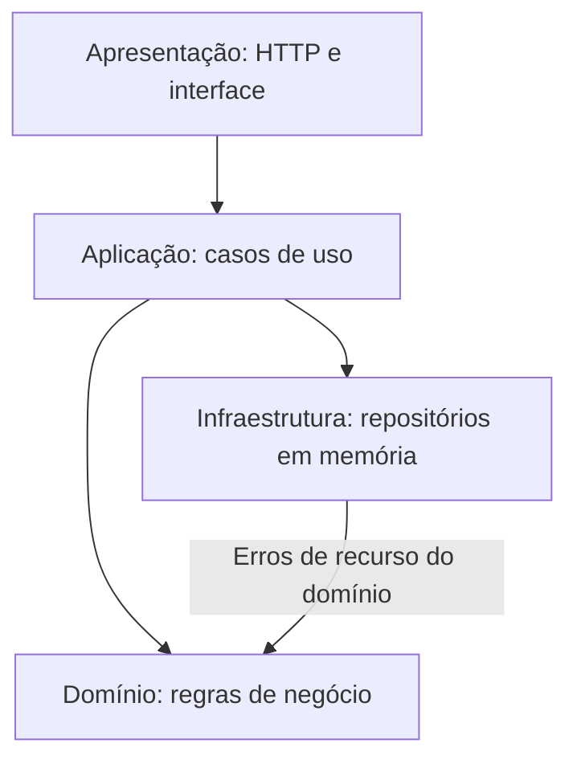
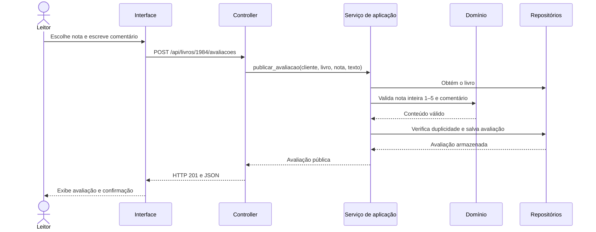

# Arquitetura multicamadas — Livraria Entrelinhas

A aplicação separa apresentação, aplicação, domínio e infraestrutura em quatro
camadas lógicas. Ela é executada como um único programa Flask, com frontend
funcional e armazenamento em memória.

## Responsabilidades

| Camada | Arquivos | Responsabilidade |
| --- | --- | --- |
| Apresentação | `controllers/livraria_controller.py`, `templates/index.html`, `static/css/app.css`, `static/js/app.js` | Receber HTTP, identificar a sessão, validar o formato das requisições, apresentar dados e capturar ações. |
| Aplicação | `services/livraria_service.py` | Coordenar os casos de uso: buscar livros, reservar, participar de eventos e publicar avaliações; proteger operações compostas com o mesmo lock do estado. |
| Domínio | `domain/regras.py`, `domain/avaliacao.py` | Aplicar regras e validações de datas, quantidades, disponibilidade para reserva, preferências, nota e comentário. |
| Infraestrutura/dados | `repositories/livros.py`, `repositories/estado.py` | Armazenar livros e estado, consultar e salvar registros e manter a autoria interna das avaliações. |

`app.py` configura o Flask e conecta a apresentação ao serviço.
`demonstracao.py` compõe o serviço com os repositórios em memória e os dados
iniciais ilustrativos. `livraria.py` e `models/` são módulos de compatibilidade
com os imports anteriores, sem duplicação da implementação.

## Dependências

As camadas são lógicas; não exigem servidores separados. O domínio não importa
Flask, serviços ou repositórios. A infraestrutura não importa os controladores
ou os serviços. Os controladores chamam o serviço e não manipulam o armazenamento.

O serviço recebe repositórios por injeção de dependência. A mesma interface
pública `Livraria(livros=None, agora=None)` continua disponível; testes ou outras
composições podem informar `repositorio` e `dados` explicitamente.

## Exemplo: publicar uma avaliação

A autoria vem da sessão, e o corpo da requisição aceita somente `nota` e `texto`.
A regra permite uma avaliação por cliente e livro. A verificação e a gravação
ocorrem dentro da mesma operação atômica, evitando duplicação entre threads.

A apresentação confirma a publicação usando a avaliação retornada pelo POST,
sem depender de uma consulta posterior. Ao abrir um livro, consulta os detalhes
e o campo `ja_avaliou` da sessão. Comentários são escapados na renderização,
e erros de envio ficam junto ao formulário, preservando o rascunho para nova tentativa.

## Armazenamento e contratos

Os repositórios mantêm dados em memória. As referências de trabalho usadas pelo
serviço são manipuladas dentro das operações atômicas; as respostas públicas
recebem cópias, evitando alteração externa do estado por meio de uma consulta.
A associação entre livro e cliente fica apenas no repositório; a avaliação pública
contém um identificador de leitor diferente do identificador bruto da sessão.

Reiniciar o servidor remove as alterações. A sessão identifica o cliente nesta
demonstração e não implementa autenticação. O contrato completo e os critérios
executáveis estão em [livraria.md](specs/livraria.md). Os resultados observados
estão em [Validação multicamadas](validacao-multicamadas.md).
